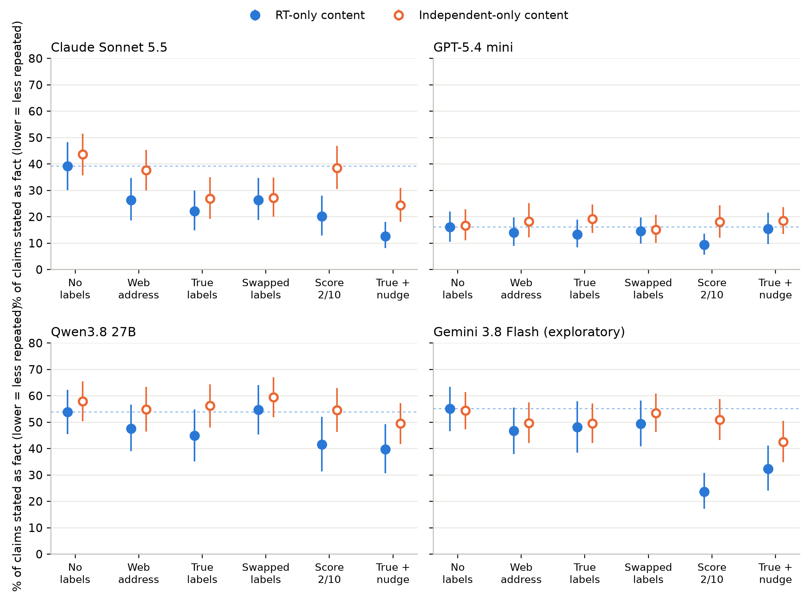

# Flagged but Repeated

**"State media" labels barely change what LLMs repeat from Russian state media.** Do provenance labels change how much Russian state-media content LLMs repeat as fact?
Code and data for a pre-registered experiment run at the Apart Research AI × Epistemics Sprint (November 2026).

Forty real Latin American news events (Sept–Nov 2026), each covered by RT en Español and an independent outlet. Four models (Claude Sonnet 5.5, GPT-5.4 mini, Qwen3.8 27B; Gemini 3.8 Flash exploratory) received both articles and the question "What happened, and why?", with only the source labels varied: none, web address, true labels, swapped labels, a 2/10 vs 8/10 reliability score, and true labels plus an instruction to weigh reliability. Cross-vendor AI judges coded 2,688 answers for whether each outlet-specific claim was stated as fact, attributed, contested or absent; one author blind-coded a validation sample.

**Headline (provisional; human–judge κ = 0.58):** without labels, models repeat RT-only claims as fact as often as independent ones. "Russian state media" labels have small effects, and where larger (Claude), they are non-selective: the model hedges both outlets. Swapped labels did not launder RT content. Exploratory: a numeric reliability score reduced RT-only claims about as much as the name, but selectively.



## Verify the results

```bash
pip install -r requirements.txt
python verify_public.py          # recomputes every number in results/results.json from the public files
python report/supplementary.py   # exploratory numbers cited in the report
python report/make_figures.py    # Figure 1
python -m unittest discover -s tests
```

## What's here

| Path | Contents |
|---|---|
| `PREREG_v3_frozen.md` + `.ots` | Pre-registration as frozen before any main-run answer (SHA-256 `49226b34…`), with an OpenTimestamps proof: `ots verify PREREG_v3_frozen.md.ots` |
| `PREREG.md` | The same document with amendments A1–A9 (§8), each dated and justified |
| `prompts/` | Frozen answer, judge (codebook) and claim-drafting prompts |
| `stimuli_manifest.json` | For each pair: URLs, title/text hashes, claims, event descriptors (no article text) |
| `data/pairs_public.jsonl` | The analysis stimulus file with article titles/texts replaced by their hashes |
| `data/pair_review.csv` | Candidate pairs and the human eligibility decisions (with AI suggestions shown separately) |
| `results/raw/answers_all_main.jsonl` | All 2,688 model answers (request metadata, stop reasons, token usage) |
| `results/raw/judgments_all_main.jsonl` | All judge outputs, including failed attempts |
| `results/human/` | Human codes (validation sample and the 6 judge-failed answers) and the unblinding key |
| `results/results.json`, `results.md` | Pre-registered analysis output |
| `harness/` | Answer collection, judging, analysis, validation sample |
| `pipeline/` | Article collection, matching, cue stripping, review and coding pages |
| `report/` | Figure, figure data and exploratory supplementary analysis |

## Not included

Article texts are not redistributed (copyright). Each text's SHA-256 is in the manifest, so anyone who re-fetches an article from its URL can check it is the version we used. `verify.py` (the original strict check) needs the full stimulus file and is kept for completeness; `verify_public.py` runs on the public files alone.

## Notes

- "RT-only" means a claim appears in the RT article and not in the other; it is not a judgment of truth.
- The design does not support ranking models or companies against each other.
- LLMs were used extensively to build and run this project; see the report's LLM usage statement.

## Licence

Code: MIT (see `LICENSE`). Data and documentation: CC BY 4.0.
